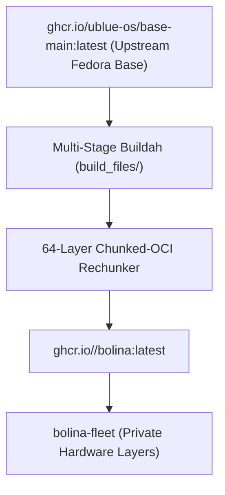

# Architecture: Bolina Base Image

High-level architecture, module boundaries, directory structure, and build pipeline for the hardware-agnostic `bolina` cloud-native base operating system.

---

## 1. Architectural Model & Responsibilities

`bolina` provides a modern, cloud-native desktop base image built on Fedora Atomic / bootc:
- **Stateless Base:** Pure declarative OCI container built via multi-stage Buildah (`Containerfile`).
- **Memory Safety & Drop-in Tooling:** Native Rust system replacements active out-of-the-box (`uutils-coreutils`, `uutils-findutils`, `uutils-diffutils`, `sudo-rs`, `ntpd-rs`).
- **Kernel & Scheduling:** CachyOS LTO performance kernel with BCacheFS/ZFS modules and eBPF schedulers (`scx`).
- **Wayland Desktop Environment:** Niri scrollable tiling Wayland compositor paired with DankMaterialShell (DMS) desktop shell.
- **Stateless Application Layer:** Flatpak, Distrobox containerization, Homebrew for user tooling.



---

## 2. Directory Tree & Key Components

```text
bolina/
├── .github/workflows/
│   ├── bolina-daemon.yml        # Dedicated Rust daemon release builder (triggered only on tools/ changes)
│   ├── build.yml                # Main OCI container build and 64-layer rechunker
│   └── build-disk.yml           # Bootable raw disk and ISO image generator
├── build_files/                 # Modular build pipeline scripts
│   ├── 01-copr.sh               # Repository bootstrapping (COPRs)
│   ├── 02-kernel.sh             # CachyOS kernel replacement & Dracut initramfs
│   ├── 03-cli-packages.sh       # Terminal toolchains, shell utilities, signing tools
│   ├── 04-desktop-packages.sh   # Desktop environment, Niri, DMS, Qt runtime/QML modules, GTK portals
│   └── 05-system-config.sh      # User configuration, systemd services, cleanup
├── etc/                         # Declarative OS configurations copied into /etc
│   ├── greetd/                  # Display manager, hybrid biometric/PAM login
│   ├── niri/                    # System fallback compositor configuration
│   ├── polkit-1/rules.d/        # Polkit access rules (fprint, uupd, dms)
│   ├── systemd/                 # Background system & user units (scx, uupd, topgrade)
│   └── wireplumber/             # Dynamic target routing & ALSA rules
├── docs/
│   ├── architecture.md          # This document: system structure and directory layout
│   └── historical-errors.md     # Living architectural memory of resolved base OS challenges
├── tools/
│   └── bolina-daemon/           # Compiled native Rust daemon: autorotate, physical chassis-lock wallpaper, input-sync, wacom-reset
├── AGENTS.md                    # Coding standards and base image guidelines
├── Containerfile                # Root build definition
└── Justfile                     # Local development recipes
```

---

## 3. Rust Drop-in Replacements & System Security

To enhance memory safety and execution performance across core operating system layers, `bolina` integrates drop-in Rust replacements for standard GNU/C utilities:

- **Coreutils, Findutils, Diffutils (`uutils`):** Prebuilt statically linked binaries installed to `/usr/bin/uutils-*` and dynamically symlinked into `/usr/local/bin` (`cp`, `mv`, `rm`, `cat`, `ls`, `find`, `xargs`, `diff`, `cmp`). Because `/usr/local/bin` precedes `/usr/bin` in `$PATH`, all interactive shell sessions and user scripts invoke Rust implementations, while package manager internals retain `/usr/bin` GNU binaries intact. Newly supported multicall tools are symlinked automatically via `--list` upon Renovate version bumps.
- **Privilege Delegation (`sudo-rs`):** Integrated in `/usr/bin/sudo-rs` with symlinks providing drop-in `sudo`, `visudo`, and `sudoedit`.
- **Network Time Daemon (`ntpd-rs`):** Replaces legacy `chrony` using the memory-safe Network Time Protocol daemon from the ISRG Prossimo project. Runs under an unprivileged `ntpd-rs` system service with minimal capabilities (`CAP_SYS_TIME`, `CAP_NET_BIND_SERVICE`).
- **Bolina System Daemon (`bolina-daemon`):** Native multi-call daemon replacing legacy Python/Bash hardware scripts with subcommands: `autorotate`, `wallpaper`, `input-sync`, and `wacom-reset`.

---

## 4. Deployment & CI/CD Pipeline

1. **GitHub Actions Build (`build.yml`):**
   - Stage 1 (`builder`): Downloads fonts, shell plugins, and utilities with deterministic SHA256 verification.
   - Stage 2 (assembly): Executes `build_files/*.sh` atomically in memory.
   - Stage 3 (`rechunker`): Repackages image using native Chunked-OCI composition (`--bootc --max-layers 64`) aligned with `--previous-build`.
2. **Registry Dispatch:**
   - On push to `main`, triggers a repository dispatch to `bolina-fleet` with `FLEET_DISPATCH_TOKEN` to initiate automated micro-layer builds.
