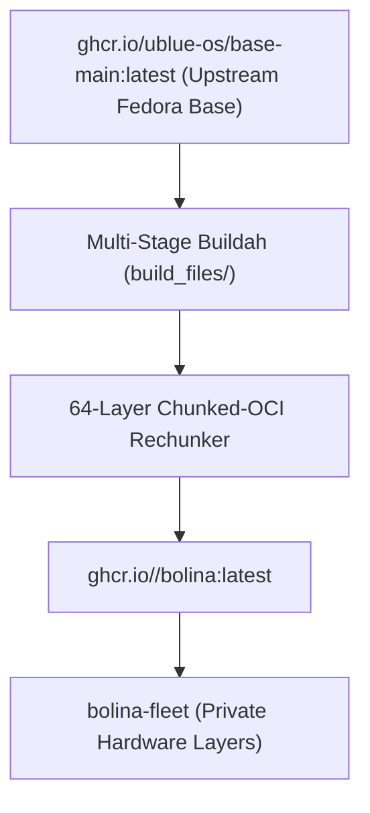

# Architecture: Bolina Base Image

High-level architecture, module boundaries, directory structure, and build pipeline for the hardware-agnostic `bolina` cloud-native base operating system.

---

## 1. Architectural Model & Responsibilities

`bolina` provides a modern, cloud-native desktop base image built on Fedora Atomic / bootc:
- **Stateless Base:** Pure declarative OCI container built via multi-stage Buildah (`Containerfile`).
- **Memory Safety & Drop-in Tooling:** Native Rust system replacements active out-of-the-box (`uutils-coreutils`, `uutils-findutils`, `sudo-rs`, `ntpd-rs`).
- **Kernel & Scheduling:** CachyOS LTO performance kernel with BCacheFS/ZFS modules and eBPF schedulers (`scx`).
- **Wayland Desktop Environment:** Niri scrollable tiling Wayland compositor paired with DankMaterialShell (DMS) desktop shell.
- **Stateless Application Layer:** Flatpak, Distrobox containerization, Homebrew for user tooling.



---

## 2. Top-Level Structure & Module Boundaries

```text
bolina/
├── .github/workflows/           # CI/CD pipelines (main build, rechunker, daemon releases, tablet sync)
├── build_files/                 # Modular build pipeline stages (01-copr through 05-cleanup)
├── etc/                         # Declarative base OS configs (greetd, niri, polkit, systemd, wireplumber)
├── usr/                         # Base system binary overlays and helper wrappers (bolina-osk)
├── tools/                       # Native Rust system utilities (bolina-daemon multi-call binary)
├── docs/                        # Architecture documentation and living error memory
├── AGENTS.md                    # Base OS operational playbook and guardrails
├── Containerfile                # Multi-stage root Buildah OCI image definition
└── Justfile                     # Local development recipes
```

---

## 3. Rust Drop-in Replacements & System Security

To enhance memory safety and execution performance across core operating system layers, `bolina` integrates drop-in Rust replacements for standard GNU/C utilities:

- **Coreutils & Findutils (`uutils`):** Prebuilt statically linked binaries installed to `/usr/bin/uutils-*` and dynamically symlinked into `/usr/local/bin` (`cp`, `mv`, `rm`, `cat`, `ls`, `find`, `xargs`). Because `/usr/local/bin` precedes `/usr/bin` in `$PATH`, all interactive shell sessions and user scripts invoke Rust implementations, while package manager internals retain `/usr/bin` GNU binaries intact. Newly supported multicall tools are symlinked automatically via `--list` upon Renovate version bumps. Incomplete or experimental tools (e.g. `diffutils`, `sed`, `grep`) are strictly excluded until achieving verified full CLI parity.
- **Privilege Delegation (`sudo-rs`):** Integrated in `/usr/bin/sudo-rs` with symlinks providing drop-in `sudo`, `visudo`, and `sudoedit`.
- **Network Time Daemon (`ntpd-rs`):** Replaces legacy `chrony` using the memory-safe Network Time Protocol daemon from the ISRG Prossimo project. Runs under an unprivileged `ntpd-rs` system service with minimal capabilities (`CAP_SYS_TIME`, `CAP_NET_BIND_SERVICE`).
- **Bolina System Daemon (`bolina-daemon`):** Native multi-call daemon replacing legacy Python/Bash hardware scripts with subcommands: `autorotate` (dual-accelerometer IIO tracking with stateful tablet latch and table flat-lock), `wallpaper` (apply, prerender, inotify watcher, and XOPP editor), `input-sync` (compiling `dms/input.kdl` + `input-hardware.kdl` into `dms/input-active.kdl` for Niri), and `wacom-reset`.
- **Touchscreen & Tablet Ecosystem (`niri-tablet`, `wvkbd`, `bolina-osk`):** Native touchscreen gesture pipeline powered by the `niri-tablet` 20-patch series (3-finger resize/carousel, 3-finger tap maximize, 4-finger overview/close/fullscreen, hold-swipe window relocation, single-finger edge swipes, client touch cancellation and touch point visualization). Integrated with `wvkbd-mobintl` via `/usr/bin/bolina-osk` and dynamically resized during physical rotation by `bolina-daemon autorotate`. Includes the GTK4 GUI configurator `niri-tablet-easysetup` and automated upstream tracking via `.github/workflows/niri-tablet.yml`.

---

## 4. Deployment & CI/CD Pipeline

1. **GitHub Actions Build (`build.yml`):**
   - Stage 1 (`builder`): Downloads fonts, shell plugins, and utilities with deterministic SHA256 verification.
   - Stage 2 (assembly): Executes `build_files/*.sh` atomically in memory.
   - Stage 3 (`rechunker`): Repackages image using native Chunked-OCI composition (`--bootc --max-layers 64`) aligned with `--previous-build`.
2. **Registry Dispatch:**
   - On push to `main`, triggers a repository dispatch to `bolina-fleet` with `FLEET_DISPATCH_TOKEN` to initiate automated micro-layer builds.
