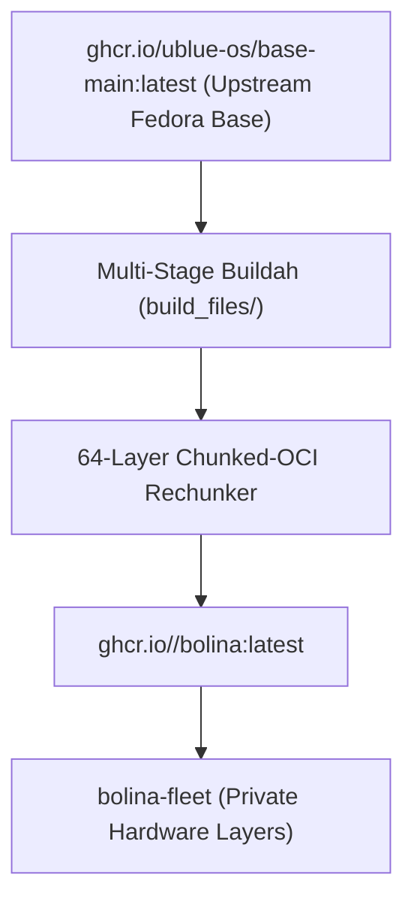

# Architecture: Bolina Base Image

High-level architecture, module boundaries, directory structure, and build pipeline for the hardware-agnostic `bolina` cloud-native base operating system.

---

## 1. Architectural Model & Responsibilities

`bolina` provides a modern, cloud-native desktop base image built on Fedora Atomic / bootc:
- **Stateless Base:** Pure declarative OCI container built via multi-stage Buildah (`Containerfile`).
- **Kernel & Scheduling:** CachyOS LTO performance kernel with BCacheFS/ZFS modules and eBPF schedulers (`scx`).
- **Wayland Desktop Environment:** Niri scrollable tiling Wayland compositor paired with DankMaterialShell (DMS) desktop shell.
- **Stateless Application Layer:** Flatpak, Distrobox containerization, Homebrew for user tooling.



---

## 2. Directory Tree & Key Components

```text
bolina/
├── .github/workflows/
│   ├── build.yml                # Main OCI container build and 64-layer rechunker
│   └── build-disk.yml           # Bootable raw disk and ISO image generator
├── build_files/                 # Modular build pipeline scripts
│   ├── 01-copr.sh               # Repository bootstrapping (COPRs)
│   ├── 02-kernel.sh             # CachyOS kernel replacement & Dracut initramfs
│   ├── 03-cli-packages.sh       # Terminal toolchains, shell utilities, signing tools
│   ├── 04-desktop-packages.sh   # Desktop environment, Niri, DMS, Qt runtime/QML modules, GTK portals
│   └── 05-system-config.sh      # User configuration, systemd services, cleanup
├── etc/                         # Declarative OS configurations copied into /etc
│   ├── greetd/                  # Display manager, hybrid biometric/PAM login
│   ├── niri/                    # System fallback compositor configuration
│   ├── polkit-1/rules.d/        # Polkit access rules (fprint, uupd, dms)
│   ├── systemd/                 # Background system & user units (scx, uupd, topgrade)
│   └── wireplumber/             # Dynamic target routing & ALSA rules
├── docs/
│   ├── architecture.md          # This document: system structure and directory layout
│   └── historical-errors.md     # Living architectural memory of resolved base OS challenges
├── AGENTS.md                    # Coding standards and base image guidelines
├── Containerfile                # Root build definition
└── Justfile                     # Local development recipes
```

---

## 3. Deployment & CI/CD Pipeline

1. **GitHub Actions Build (`build.yml`):**
   - Stage 1 (`builder`): Downloads fonts, shell plugins, and utilities with deterministic SHA256 verification.
   - Stage 2 (assembly): Executes `build_files/*.sh` atomically in memory.
   - Stage 3 (`rechunker`): Repackages image using `rpm-ostree compose build-chunked-oci --max-layers 64` aligned with `--previous-build`.
2. **Registry Dispatch:**
   - On push to `main`, triggers a repository dispatch to `bolina-fleet` with `FLEET_DISPATCH_TOKEN` to initiate automated micro-layer builds.
